## hey, i'm umut

Mostly writing Rust these days. I also know my way around Java, TypeScript, Svelte and whatever else a project ends up needing.

Right now I'm working on **Trawl**, a download manager I started because I got tired of the ones out there. Rust + Tauri on the back, Svelte for the UI, and a browser extension that catches videos and files right off the page.

### right now

- getting trawl ready for a first release
- learning German, one Nebensatz at a time

### projects

**[trawl](https://github.com/saiv0n/trawl)** · multi-connection downloads that survive crashes, YouTube and 1800+ other sites through yt-dlp, and a Chrome/Firefox extension that takes over your downloads.

**[nebensaetze](https://github.com/saiv0n/nebensaetze)** · a small site I made while learning German, all about subordinate clauses and where the verb goes. [live here](https://nebensaetze.vercel.app)

  

<picture>
  <source media="(prefers-color-scheme: dark)" srcset="https://raw.githubusercontent.com/saiv0n/saiv0n/output/snake-dark.svg">
  
</picture>
